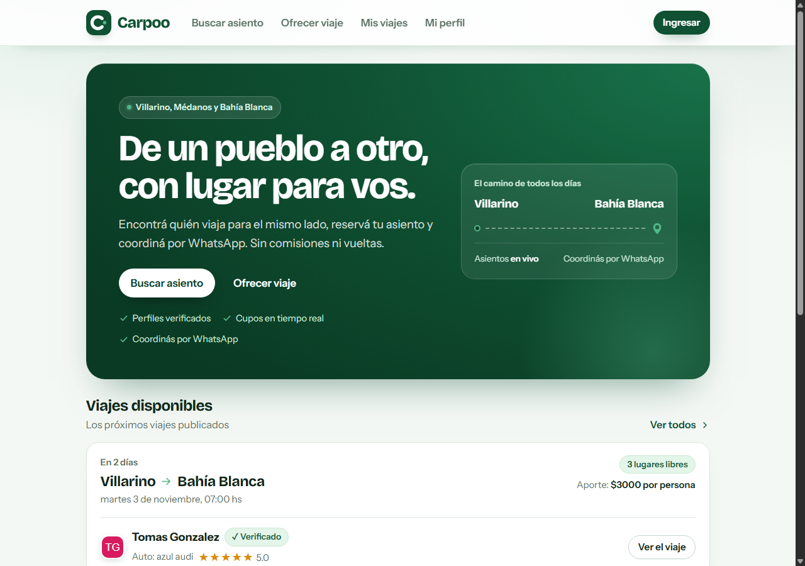
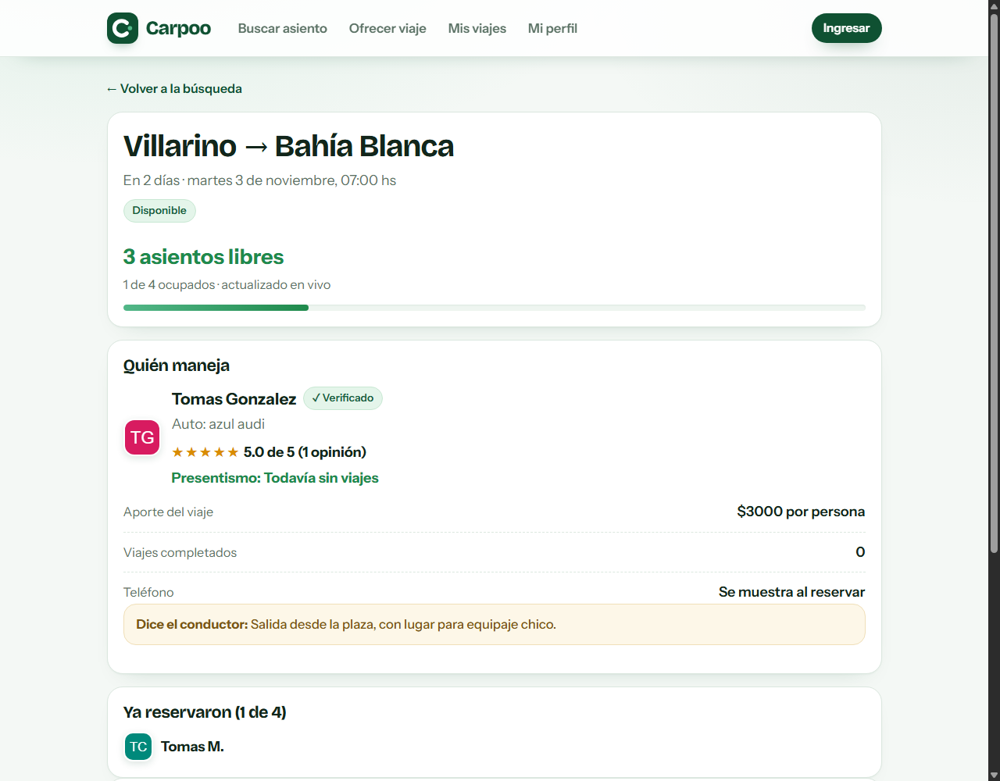
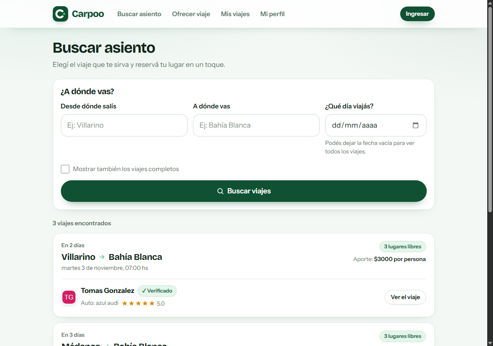
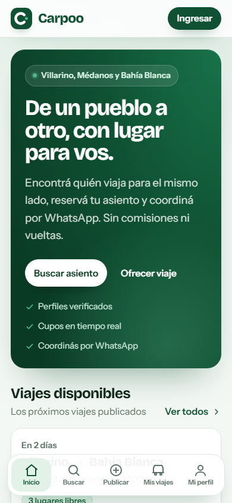
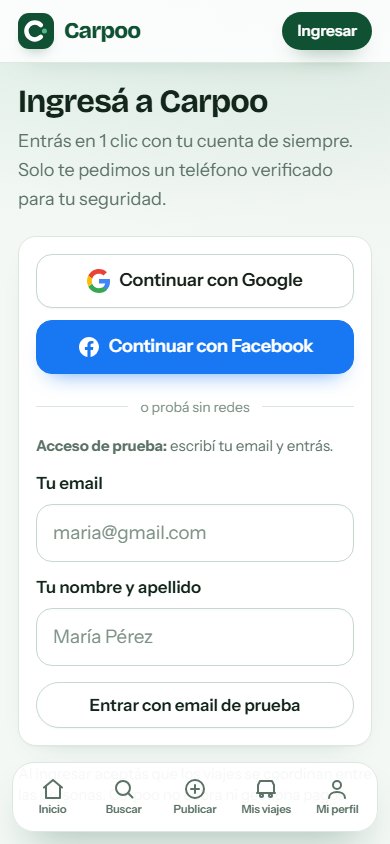

# Carpoo

**Viajes compartidos entre pueblos, sin grupos de WhatsApp.**

Carpoo conecta a gente que viaja entre Villarino, Médanos, Bahía Blanca y alrededores. Un
conductor publica su viaje (origen, destino, día, hora y asientos) y un pasajero pide un lugar en
dos toques. El conductor acepta, el cupo se descuenta en vivo y la app los conecta por WhatsApp
para arreglar el punto de encuentro y el aporte.

No hay perfiles anónimos: cada viaje cuelga de una cuenta real con **foto** y **teléfono
verificado**. Antes de subir a un auto se ve la **reputación** y el **presentismo** de la otra
persona. **No se cobra nada dentro de la app**: Carpoo solo conecta a las personas.

> ### Proyecto en construcción
> Esto es un MVP funcional, no un producto terminado. Hay cosas que faltan y cosas que van a
> cambiar (mirá el [roadmap](#roadmap)). Está publicado como pieza de portafolio.
>
> ### Hecho a mano con IA
> Carpoo se construyó **en colaboración con IA, en sesiones de trabajo largas y con ida y vuelta
> constante**: yo tomaba las decisiones de producto, de diseño y de negocio; la IA escribía código,
> proponía alternativas y ejecutaba. Fue también una **prueba de hasta dónde llega hoy un agente de
> código** en un proyecto real: autenticación OAuth propia, transacciones para no sobrevender,
> diseño completo y despliegue. Todo el código, los textos y este README se escribieron así.

---

## Capturas

| Inicio (escritorio) | Detalle del viaje |
| --- | --- |
|  |  |

| Buscador | Inicio (celular) | Ingreso |
| --- | --- | --- |
|  |  |  |

---

## El problema

Entre pueblos no hay transporte público frecuente y coordinarlo termina siempre igual: un grupo de
WhatsApp enorme, mensajes que se pierden, gente que escribe "¿alguien va mañana?" y nadie sabe si
queda lugar. Carpoo resuelve tres cosas concretas:

1. **Ver los viajes disponibles** en un lugar, con fecha, hora y asientos reales.
2. **No sobrevender**: el cupo se descuenta con transacciones, no "a ojo".
3. **Saber con quién viajás**: foto, teléfono verificado, estrellas y presentismo.

---

## Cómo funciona

**Conductor**
1. Inicia sesión con Google o Facebook y verifica su teléfono.
2. Publica el viaje: origen, destino, fecha, hora, asientos (1 a 8), aporte y notas.
3. Recibe las **solicitudes de asiento** en *Mis viajes* y las **acepta o rechaza**.
4. Al aceptarlas, el asiento se descuenta y se habilita el WhatsApp con cada pasajero.
5. Al terminar, marca a cada pasajero como **Viajó** o **No vino** (alimenta el presentismo).

**Pasajero**
1. Busca por origen, destino y fecha.
2. Pide un asiento. La solicitud queda **pendiente** y **no descuenta cupo** todavía.
3. Cuando el conductor acepta, el lugar queda confirmado y aparece el **botón de WhatsApp**.
4. Puede cancelar cuando quiera: el asiento vuelve a quedar libre.
5. Después del viaje, califica con 1 a 5 estrellas.

**Reglas de confianza**
- Sin **foto + teléfono verificado** no se puede publicar ni pedir un asiento.
- El teléfono del conductor **no se muestra** hasta que hay una reserva confirmada o asistida.
- Presentismo = viajes asistidos ÷ (asistidos + ausencias), visible en el perfil público.

---

## Funcionalidades

**Conductor**
- Publicar un viaje con formulario simple y validación en el servidor.
- Panel *Mis viajes* con solicitudes pendientes, pasajeros anotados y ocupación en vivo.
- Editar, cancelar (libera los cupos) y finalizar el viaje.
- Botón de WhatsApp con el mensaje ya redactado para cada pasajero.

**Pasajero**
- Buscador *"¿A dónde vas?"* con filtros por origen, destino y fecha.
- Tarjetas con foto del conductor, auto, hora, asientos libres, reputación y presentismo.
- *Mis reservas*: cancelar, confirmar *"Sí, viajé"* y escribir por WhatsApp.

**Cuenta y confianza**
- Login en un clic con **Google** o **Facebook** (OAuth propio, sin librerías de auth).
- **Acceso de prueba** por email para demos, sin contraseña.
- Verificación del teléfono con **código de 6 dígitos** (en modo demo se muestra en pantalla;
  con Twilio configurado, llega por SMS).
- Reputación de 1 a 5 estrellas con comentario y perfil público.

**Experiencia**
- Mobile-first, botones grandes, alto contraste y textos en español rioplatense.
- Barra inferior flotante en el celular, navegación clásica en escritorio.
- La mayoría de la UI son **componentes de servidor**: poco JavaScript en el cliente.

---

## Tecnologías

| Pieza | Elección | Por qué |
| --- | --- | --- |
| Framework | **Next.js 16.4** (App Router, Server Actions) | Un solo proyecto para pantallas y lógica; los formularios no necesitan una API aparte. |
| UI | **React 19.3** + **TypeScript** | Tipado de punta a punta y componentes modernos. |
| Estilos | **Tailwind CSS v4** + tokens propios en `globals.css` | Diseño consistente con variables CSS y clases reutilizables. |
| Base de datos | **Prisma 6** + **SQLite** en local / **Postgres** en producción | SQLite es un archivo: cero instalación para probar. En Vercel, Postgres. |
| Sesión | **jose** (JWT HS256 en cookie `httpOnly`) | Liviano, sin dependencias pesadas. |
| OAuth | Implementación propia en `src/lib/oauth.ts` | Flujo *authorization code* de Google y Facebook, sin librerías extra. |
| SMS | **Twilio** (opcional) | Verificación real del teléfono; sin claves, el código se muestra en pantalla. |
| Tipografías | **Bricolage Grotesque** + **Instrument Sans** (autohospedadas, OFL) | Sin depender de Google Fonts en tiempo de ejecución. |

> Las páginas leen datos vivos (viajes, cupos, reservas), por eso `cacheComponents: false` y render
> dinámico clásico. No hay caché que pueda mostrar un cupo viejo.

---

## Arquitectura

```
Carpoo/
├─ prisma/
│  ├─ schema.prisma          # Modelo de datos (User, Trip, Reservation, Review)
│  ├─ seed.mts               # Datos de ejemplo (npm run db:seed)
│  └─ dev.db                 # SQLite local (generado, no se commitea)
├─ public/
│  ├─ avatares/              # Logo y fotos de ejemplo en SVG
│  └─ fuentes/               # Tipografías .woff2 + su licencia
├─ scripts/
│  └─ preparar-postgres.mjs  # Genera el schema Postgres solo para el deploy
├─ src/
│  ├─ app/                   # Rutas (App Router)
│  │  ├─ page.tsx            # Inicio: hero + últimos viajes
│  │  ├─ buscar/             # Buscador de asientos
│  │  ├─ viajes/[id]/        # Detalle: cupos en vivo, reservar, reseñas
│  │  ├─ publicar/           # Publicar un viaje
│  │  ├─ mis-viajes/         # Panel del conductor
│  │  ├─ mis-reservas/       # Reservas del pasajero
│  │  ├─ perfil/             # Foto, teléfono, auto y reputación
│  │  ├─ usuarios/[id]/      # Perfil público
│  │  ├─ ingresar/           # Login Google/Facebook + acceso de prueba
│  │  └─ api/                # OAuth (signin/callback) y cupos en vivo (JSON)
│  ├─ components/            # Header, barra inferior, tarjetas y formularios
│  └─ lib/
│     ├─ actions/            # Server Actions: auth, trips, reservations
│     ├─ session.ts          # Cookie de sesión + regla de perfil completo
│     ├─ oauth.ts            # Google y Facebook (authorization code)
│     ├─ queries.ts          # Consultas de lectura
│     ├─ stats.ts            # Reputación, presentismo e historial
│     ├─ validate.ts         # Teléfonos, links de WhatsApp, limpieza de texto
│     ├─ messages.ts         # Textos prearmados de WhatsApp
│     └─ notify.ts           # Códigos de verificación (consola / Twilio)
└─ next.config.ts
```

### Modelo de datos

| Modelo | Para qué |
| --- | --- |
| `User` | Cuenta real: nombre, foto, proveedor OAuth, teléfono verificado, datos del auto, `isAdmin`. |
| `Trip` | Viaje publicado: origen, destino, fecha/hora, `seatsTotal`/`seatsTaken`, estado y aporte. |
| `Reservation` | Solicitud o reserva: `PENDING → CONFIRMED → ATTENDED / NO_SHOW`, única por persona y viaje. |
| `Review` | 1 a 5 estrellas + comentario, única por autor/viaje/destinatario. |

### Decisiones técnicas que vale la pena mirar

- **Reserva sin sobreventa**: la aceptación corre en `prisma.$transaction` con un `updateMany`
  condicionado a `seatsTaken < seatsTotal`. Si dos personas aceptan a la vez el último asiento, una
  falla y la otra entra. El viaje pasa a `FULL` solo.
- **Sin librería de autenticación**: OAuth a mano (3 pasos: redirigir, recibir el `code`,
  cambiarlo por el perfil) y sesión JWT firmada. Menos dependencias, más control.
- **Validación siempre en el servidor**: cada Server Action verifica sesión, propiedad del recurso y
  limpia los datos (`cleanText`, `cleanInt`, `normalizePhone`). El cliente no es confiable.
- **Privacidad del teléfono**: se oculta en las consultas hasta que exista reserva confirmada.
- **Cupos en vivo**: un endpoint liviano devuelve los asientos cada 7 segundos, sin recargar la
  página.
- **SQLite en local, Postgres en Vercel**: `scripts/preparar-postgres.mjs` genera una copia del
  schema con `provider = "postgresql"` solo durante el build. El desarrollo local sigue siendo un
  archivo y no necesita instalar una base.

---

## Correr el proyecto en local

Requisitos: **Node 20.9+** (probado con 22 y 24) y npm. No hace falta instalar ninguna base de datos.

```bash
# 1. Dependencias (corre prisma generate solo)
npm install

# 2. Variables de entorno
cp .env.example .env        # Windows: Copy-Item .env.example .env

# 3. Generar la clave de sesión y pegarla en AUTH_SECRET
node -e "console.log(require('crypto').randomBytes(48).toString('hex'))"

# 4. Base de datos + datos de ejemplo
npm run db:push
npm run db:seed

# 5. Levantar
npm run dev
```

Abrí **http://localhost:3000**.

`.env` mínimo para probar:

```env
DATABASE_URL="file:./dev.db"
APP_URL="http://localhost:3000"
AUTH_SECRET="<la clave larga que generaste>"
DEMO_LOGIN="true"
```

> **Zona horaria:** las fechas se formatean en el servidor. Para ver las horas de Argentina,
> arrancá con `TZ=America/Argentina/Buenos_Aires` (Linux/macOS) o configurá la zona en Windows.

### Entrar a probar

En **/ingresar** hay dos caminos:

- **Acceso de prueba**: escribís un email y entrás sin contraseña (ideal para ver la app rápido).
- **Google / Facebook**: solo si cargaste las claves (ver abajo).

Emails del seed:

| Email | Persona | Para qué sirve |
| --- | --- | --- |
| `maria@ejemplo.com` | María Fernández | Conductora con viajes, reputación 5.0 y presentismo. |
| `jorge@ejemplo.com` | Jorge Almada | Un viaje completo y otro con lugares libres. |
| `lucia@ejemplo.com` | Lucía Rossi | Pasajera con reservas e historial. |
| `diego@ejemplo.com` | Diego Sosa | Tiene una ausencia registrada (presentismo bajo). |
| `ana@ejemplo.com` | Ana Gutiérrez | **Teléfono sin verificar**: muestra el flujo "Completá tu perfil". |

Cualquier otro email crea una persona nueva de prueba.

---

## Guía de prueba (recorrido de 3 minutos)

1. **Publicar**: entrá con `maria@ejemplo.com` → *Ofrecer viaje* → completá y publicá.
2. **Pedir asiento**: en una ventana incógnito, entrá con `lucia@ejemplo.com` → *Buscar asiento* →
   abrí el viaje → *Pedir asiento*. El cupo **todavía no baja**: queda pendiente.
3. **Aceptar**: volvé a la ventana de María → *Mis viajes* → **Aceptar**. Ahí sí baja 1 asiento y se
   habilita el WhatsApp.
4. **Sin sobreventa**: con el viaje lleno, intentá pedir desde otra cuenta. La app avisa que se
   llenó y el viaje queda `FULL`.
5. **Cancelar**: como pasajero en *Mis reservas*; el asiento vuelve a quedar libre.
6. **Perfil incompleto**: entrá con `ana@ejemplo.com` e intentá publicar: pide foto y teléfono. El
   código de verificación aparece **en pantalla** en modo demo.
7. **Reputación**: en un viaje ya realizado, calificá de 1 a 5 estrellas.

---

## Variables de entorno

| Variable | Obligatoria | Para qué |
| --- | --- | --- |
| `DATABASE_URL` | Sí | SQLite local (`file:./dev.db`) o Postgres en producción. |
| `APP_URL` | Sí | URL pública; se usa para armar los callbacks de OAuth. |
| `AUTH_SECRET` | Sí | Firma la cookie de sesión. Larga y aleatoria. |
| `DEMO_LOGIN` | No | `"false"` apaga el acceso de prueba. En el demo público queda `"true"`. |
| `GOOGLE_CLIENT_ID` / `GOOGLE_CLIENT_SECRET` | No | Login con Google. Sin claves, el botón aparece deshabilitado. |
| `FACEBOOK_CLIENT_ID` / `FACEBOOK_CLIENT_SECRET` | No | Login con Facebook. |
| `TWILIO_ACCOUNT_SID` / `TWILIO_AUTH_TOKEN` / `TWILIO_FROM` | No | Envío real de SMS. Sin esto, el código va a la consola y a la pantalla. |

### Callbacks de OAuth

- Google: `https://TU-DOMINIO/api/auth/callback/google`
- Facebook: `https://TU-DOMINIO/api/auth/callback/facebook`

Se cargan en la consola de cada proveedor y tienen que coincidir con `APP_URL`.

---

## Despliegue en Vercel

Vercel no puede usar SQLite (el sistema de archivos es efímero), así que el deploy usa **Postgres**.
La app ya viene preparada:

1. **Importá el repo** en [vercel.com/new](https://vercel.com/new) (framework: Next.js, sin tocar
   nada).
2. **Creá la base**: en el proyecto → *Storage* → *Create Database* → **Postgres (Neon)**, plan
   gratis. Vercel inyecta `DATABASE_URL` sola.
3. **Variables de entorno** del proyecto:

   ```env
   APP_URL="https://tu-proyecto.vercel.app"
   AUTH_SECRET="<clave larga y aleatoria>"
   DEMO_LOGIN="true"        # para el demo público; "false" en un producto real
   ```

4. **Deploy**. El script `vercel-build` se encarga del resto: genera el schema Postgres, crea las
   tablas (`prisma db push`), compila y publica.
5. **Datos de ejemplo (opcional)**, una sola vez desde tu máquina, apuntando a la base de Neon:

   ```bash
   $env:DATABASE_URL="postgresql://..."      # cadena de conexión de Neon
   npx prisma generate --schema prisma/schema.postgres.prisma
   npx prisma db push --schema prisma/schema.postgres.prisma
   node prisma/seed.mts
   npx prisma generate                        # vuelve al cliente de SQLite local
   ```

6. Si querés que funcione el login con Google/Facebook en producción, agregá los callbacks del
   dominio de Vercel en cada consola. Si no, el **acceso de prueba** sigue funcionando.

> En producción `DEMO_LOGIN="true"` permite que cualquiera entre con un email. Para el demo de
> portafolio es a propósito; en un producto real va en `"false"`.

---

## Scripts

| Comando | Qué hace |
| --- | --- |
| `npm run dev` | Desarrollo (Turbopack) en http://localhost:3000 |
| `npm run build` | Build de producción + chequeo de tipos |
| `npm run start` | Sirve el build |
| `npm run lint` | ESLint |
| `npm run db:push` | Crea/actualiza las tablas del SQLite local |
| `npm run db:seed` | Carga los datos de ejemplo |
| `npm run db:studio` | Prisma Studio |
| `npm run db:reset` | Borra todo y vuelve a seedear |

---

## Seguridad

- Sesión con **JWT HS256** firmado en cookie **`httpOnly`**, `SameSite=Lax` y `Secure` en
  producción. Sin `AUTH_SECRET` no se pueden falsificar sesiones.
- Cada Server Action verifica **sesión y propiedad** del recurso (por ejemplo, solo el conductor
  dueño del viaje puede cancelarlo).
- Aceptar un asiento usa **transacción + condición de cupo**: no se puede sobrevender.
- El teléfono del conductor se oculta hasta que exista reserva confirmada o asistida.
- Los textos se limpian y se limitan en longitud antes de guardarse.
- No hay pagos, comisiones ni datos de tarjetas: el dinero se arregla entre las partes.

---

## Roadmap

**Ya está:** publicar, buscar, pedir asiento con aprobación del conductor, cupos en vivo, login con
Google/Facebook, verificación de teléfono, perfil con foto, reputación, presentismo, WhatsApp y
estados del viaje.

**Próximo:**
- **Notificaciones sin entrar a la web**: Web Push (PWA) para que al conductor le llegue el aviso de
  una solicitud al teléfono, con la bandeja in-app como respaldo. Es gratis y no depende de terceros.
- **Recordatorios** 24 h y 2 h antes de la salida.
- **Retención del asiento**: que la solicitud reserve el lugar por 30 minutos y se libere sola si el
  conductor no responde.
- **Chat interno** para no salir a WhatsApp.
- **Denuncias y moderación** (el campo `isAdmin` ya está previsto en el modelo).
- **Viajes recurrentes** (misma ruta, todos los días) y búsqueda por cercanía.
- **Verificación más fuerte** (documento) para viajes largos.

**Descartado por ahora:** pagos dentro de la app y comisiones. La idea es que sea gratis para quien
viaja.

---

## Sobre este proyecto

Lo hice para resolver algo concreto de mi zona: moverme entre pueblos sin depender de un grupo de
WhatsApp. Me interesaba especialmente la parte de confianza (identidad verificada, reputación,
presentismo) porque es lo que hace que compartir un auto funcione entre desconocidos.

Y lo usé como **prueba de desarrollo junto a IA**: el objetivo era ver si un agente podía sostener
un proyecto completo —modelo de datos, reglas de negocio, diseño, autenticación y deploy— siempre
conmigo tomando las decisiones. El resultado está a la vista y sigue en construcción.

Si querés probarlo o darme una mano con ideas, escribime.

---

## Licencia

Código publicado para mostrar el trabajo. Si querés reutilizarlo, escribime primero.
